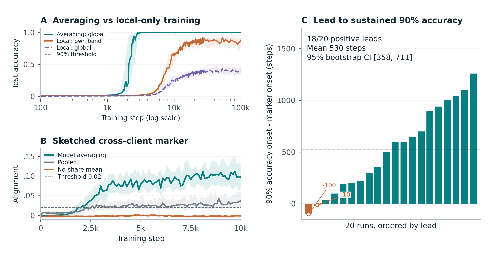

# Federated grokking: cross-client generalization diagnostics

Code and saved results for a preliminary study of whether a compact kernel diagnostic tracks emerging generalization across clients with disjoint data domains. Scientific surrogates must learn from scarce observations distributed across assets with different operating conditions; this controlled arithmetic study examines the underlying generalization question, not a surrogate deployment. The study supported subsequent research proposals on scientific surrogates and collective generalization.

I designed, implemented, ran, and analyzed the study, including the sketch, cross-client controls, and exclusion of the readout head. The pooled-data control refuted federation specificity, narrowing the interpretation to a preliminary association with generalization.

**Author:** Mayank Bakshi. **Status:** preliminary, not peer reviewed. Manuscript in preparation for conference submission; draft available upon request.

[One-page research sample](docs/research-sample.pdf)

Related exploration: [generalization transitions in synthetic language tasks with GPT-2-style decoders](explorations/gpt2_composition/) ([plain-text account](https://raw.githubusercontent.com/mayankbakshi/federated-grokking/main/explorations/gpt2_composition/README.md)). An eight-layer decoder trained from scratch on symbolic relations showed an objective-level failure: answer-only training recovered over 99.9% in-distribution atomic-fact accuracy in the saved run while out-of-distribution composition stayed near zero. Rescoring the archived full-sequence checkpoints ruled out a scoring-only explanation. This is one world and one seed per objective, with unequal training durations; it does not establish systematic compositional generalization or pronounced grokking. The linked study includes the exact setup, curves, code and saved evidence.



The release contains the complete **20-seed, three-regime diagnostic battery** (60 saved arrays) and **100 saved accuracy-comparison files** (20 model averaging runs and 80 individual local-only runs), plus analysis, plotting, and standalone training code. The figure above can be reproduced locally; no account, logging service, or model download is needed.

## Main result and its limit

Panel A compares model averaging with local-only training. Model averaging reaches high accuracy on the shared global test. Local-only models learn their own bands later and remain substantially worse on the global test. The local curves first average the four individual client accuracies within each seed, then show medians and interquartile ranges over 20 seeds. These are individual-model evaluations, distinct from the parameter-mean control in panel B. Each isolated client has roughly one quarter of the collective training data. This comparison therefore shows collaboration versus isolation; it does not isolate communication from data access or establish a speedup ratio. Pooled training supplies the data-matched control for the diagnostic.

The cross-client marker precedes **sustained 90% held-out accuracy** in 18/20 model averaging runs. The mean retrospective lead is 529.5 training steps, displayed as 530; its 95% bootstrap interval is [358.5, 711.0125], displayed as [358, 711]. The two negative leads, -100 and -10 steps, are retained.

The pooled-data control also crosses the marker threshold in **17/20 runs**. Thus the planned test of federation specificity failed. The result supports a preliminary association with the generalization transition, not a signal unique to federation or a validated online warning system. The no-sharing control crosses in 0/20 runs, but also supplies calibration and therefore cannot independently establish a false-alarm rate.

## Reproduce the exact figure and statistics

Use Python 3.13 for the pinned figure environment:

```bash
python3.13 -m venv .venv
source .venv/bin/activate
python -m pip install -r requirements-figure-lock.txt
python -m fedgrok.verify
```

This checks all 160 source-file hashes, verifies that the two saved studies agree on overlapping model averaging accuracy observations, regenerates the figure, recomputes every seed's onset and lead, recomputes the bootstrap interval, and compares the results with the reference. Outputs are written to `output/`:

- `figure.png` and `figure.svg`
- `statistics.json` and `per_seed.csv`
- `comparison.json`, recording local-only summaries and the shared-observation check
- `verification.json`, including the pixel comparison

The exact rendering check uses the reference PNG. Font/rendering differences on another platform can be inspected with `python -m fedgrok.verify --allow-rendering-differences`; data and numerical statistics must still match exactly. The verified environment and scope are recorded in [VALIDATION.md](VALIDATION.md).

## Experimental setup

The communication step uses **periodic model averaging**: all four clients synchronize by an equally weighted average every 10 optimizer steps. This is a full-participation, local-AdamW variant of the standard [FedAvg approach](https://arxiv.org/abs/1602.05629). The contribution studied here is the diagnostic and empirical analysis. Historical `fedavg` filenames and data keys are retained to preserve provenance.

| Setting | Value |
|---|---|
| Task | Modular division, z = x times inverse(y) modulo 97; y is nonzero |
| Data | 9,312 input pairs; four contiguous, disjoint x-bands |
| Split | 50% train / 50% held out within each band |
| Evaluation | Shared union of all 4,656 held-out pairs |
| Model | Two-layer pre-norm transformer; width 128, four heads, feed-forward width 512, no dropout |
| Optimizer | Full-batch AdamW; learning rate 0.001, weight decay 1.0, betas (0.9, 0.98) |
| Regimes | model averaging every 10 steps; matched pooled training; independent clients without sharing |
| Seeds | 0-19 in every regime |
| Horizon | Diagnostic battery: 0-10,000; accuracy comparison: 0-100,000, inclusive |
| Probe | 64 labeled examples per band; 256 total, fixed within a run |
| Sketch | Eight Rademacher output projections, projection seed 0 |
| Diagnostic grid | Every 100 steps |

Model averaging and pooled training share initialization and the same collective training data. Independent clients use separate initializations. The no-sharing diagnostic is evaluated at their **parameter mean**; it is not an average of their individual accuracies or kernels.

The probe samples each band's **full input domain**, independently of the train/test split, so it may include both training and held-out examples. It uses known labels and is not a held-out-only evaluation set. Separate random streams keep probe sampling and output projections from perturbing training.

Step labels follow the original implementation: **step 0 is measured after the first optimizer update**. Therefore the diagnostic loop performs 10,001 optimizer updates per trained model; the accuracy-comparison loop performs 100,001. Synchronization follows the updates at labels divisible by 10. These conventions are retained for comparability.

## What the marker measures

For each pair of probe inputs, estimate the trace neural tangent kernel by averaging gradient inner products from eight random projections of the output logits. Exclude the final readout-head parameters. Compare the resulting kernel with the label-equality Gram matrix after global centering.

Within-band and cross-band alignment are separate Frobenius cosines restricted to same-band and different-band pairs. Their numerators decompose, but the separately normalized alignment values need not add to the global alignment. Random projection is unbiased for the trace kernel; that does not imply unbiased normalized alignment or establish a detection guarantee.

The figure shows:

- **A:** model averaging on the global held-out test, and individual local-only models on their own-band and global held-out tests. The horizontal axis is logarithmic, displaying steps 100-100,000; the dashed reference line marks 90% accuracy.
- **B:** cross-band backbone kernel-label alignment for all three regimes; dashed line is 0.02.
- **C:** per-seed lead from marker onset to sustained 90% accuracy, sorted by lead.

Curves and bands in A and B are medians and interquartile ranges over 20 seeds, without smoothing. A first averages the four independent clients within each seed for each local-only curve. B covers only the 0-10,000 diagnostic horizon on a linear axis. C contains all 20 individual model averaging runs, including both negative leads. The added comparison does not change B, C, or the lead statistics.

For each seed, the marker threshold is `max(0.02, mean(local) + 3 * std(local))`, using the full no-sharing alignment trajectory and NumPy's population standard deviation. All thresholds in this battery equal 0.02. Both event definitions require every sampled checkpoint in `[s, s+300]` to remain above threshold, with a complete window. Event times are dated to `s`, so leads are retrospective. Accuracy uses the original denser evaluation grid; the kernel uses the 100-step grid. The bootstrap resamples all 20 leads 10,000 times with random seed 0. See [analysis.py](fedgrok/analysis.py).

## Run training

Use a separate Python 3.11 environment for the tested training dependencies:

```bash
python3.11 -m venv .venv-training
source .venv-training/bin/activate
python -m pip install -r requirements-training.txt
python -m pytest tests -q
python -m fedgrok.check_training

# Short execution check: smaller probe and fewer projections; not a grokking result.
python -m fedgrok.training --seeds 0 --mode all --n-steps 20 \
  --round-every 10 --per-band 2 --projections 2 --output output/smoke

# Full study settings: substantial CPU compute; outputs go to a separate directory.
python -m fedgrok.training --output output/retraining

# Accuracy comparison for A, through 100,000 steps, without kernel measurements.
python -m fedgrok.comparison --output output/comparison-training
```

The runner writes the accuracy and backbone-alignment fields used by this figure, plus its configuration. It does not recompute the unrelated auxiliary diagnostics also retained in the original NPZ files. The historical `grok_step` field was a separate reference-curve lookup; new runs set it to -1. This field does not determine the onset times or lead statistics, which are recomputed from `acc_step`, `acc`, `step`, and `A_out_backbone`.

The figure environment can plot completed new runs with `python -m fedgrok.figure --data output/retraining --comparison-data output/comparison-training --output output/retraining-figure`. The two model averaging datasets must agree exactly at shared observations. Full retraining may differ across hardware and numerical-library versions. The lead summary requires both onsets in every run and stops with an error if any are censored; a censored observation is not treated as a zero lead. Reconstructing the research-sample figure from saved results and reproducing the entire training study are distinct checks; [VALIDATION.md](VALIDATION.md) records what was actually run for this release.

## Interpretation and next steps

Grokking means delayed generalization after fitting training examples. This saved battery includes held-out accuracy but no matching training-accuracy time series, so these panels alone do not establish the training/generalization gap. The study is small-scale modular arithmetic, uses labeled probes, and does not establish practical monitoring savings, causal mechanisms, privacy guarantees, or transfer to language-model safety.

Next validation would freeze calibration before evaluation, use fresh training and projection seeds, measure approximation fidelity and end-to-end runtime, and test broader settings. The failed pooled-control specificity test remains part of the reported result.

## Files

- `docs/research-sample.pdf`: one-page study summary
- `fedgrok/`: data, model, training, kernel, analysis, plotting, and verification modules
- `data/battery/`: all 60 original saved run arrays, with `data/SHA256.json`
- `data/local_comparison/`: 20 model averaging accuracy runs and 80 individual local-only runs through 100,000 steps
- `reference/`: reference figure, complete statistics, and per-seed table
- `tests/`: numerical and experimental-invariant checks
- `study.json`: study settings and event definitions

## References and license

The modular-division task is based on [Power et al., *Grokking: Generalization Beyond Overfitting on Small Algorithmic Datasets*](https://arxiv.org/abs/2201.02177). Training here is full-batch, so step counts should not be directly compared with minibatch experiments in that paper.

Code and bundled results are distributed under the [MIT license](LICENSE). This is a preliminary research release, not a peer-reviewed publication.
