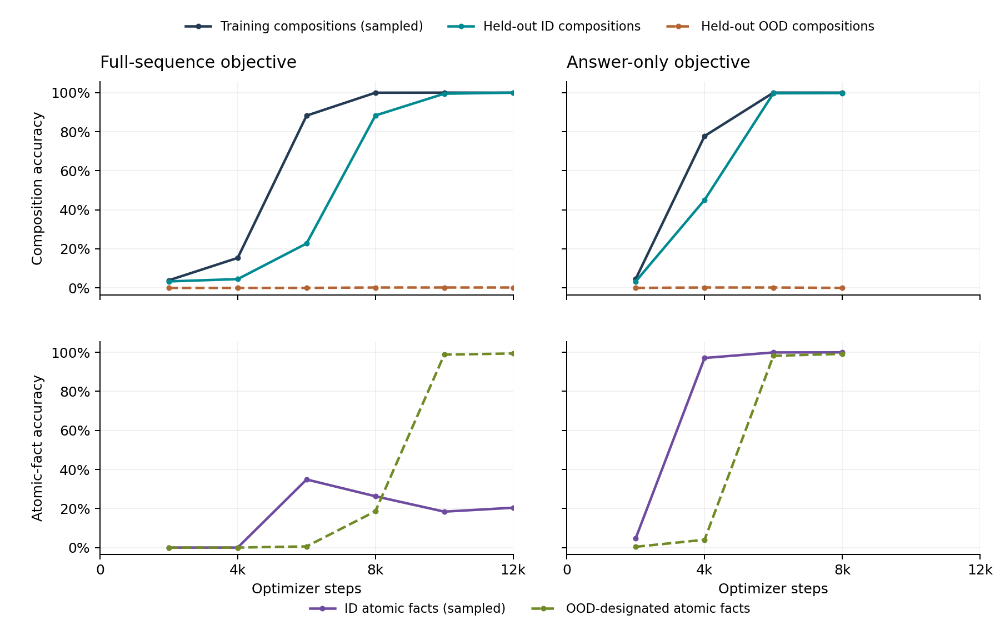

# Exploring generalization transitions in synthetic language tasks with GPT-2-style decoders

This companion exploration asks whether the separation between fitting examples and generalizing, studied in the federated arithmetic experiments, also appears in a structured language-modeling task. An eight-layer GPT-2-style decoder learns atomic relations and two-hop compositions in a synthetic knowledge graph. The experiment follows the composition setting of [Wang et al. (NeurIPS 2024)](https://arxiv.org/abs/2405.15071), with a smaller, reproducibly seeded world.

The model is trained **from random initialization**, using Hugging Face's `GPT2LMHeadModel` with a custom vocabulary. The inputs are symbolic entity/relation sequences, not natural-language text; no pretrained GPT-2 weights, BERT/RoBERTa fine-tuning, or instruction tuning are involved. These are exploratory results from one world and one training seed per objective.

## Question and experimental reasoning

The motivating question is whether high accuracy on held-out compositions reflects a reliable learned rule. Separate evaluations of familiar compositions, new compositions, and their constituent atomic facts help distinguish these possibilities.

The initial full-sequence objective produced high held-out in-distribution composition accuracy while accuracy on one group of directly trained atomic facts remained poor. This suggested a conflict in the token-prediction objective: after the same entity/relation prefix, an atomic sequence predicts an entity, whereas a longer composition sequence predicts another relation.

To distinguish an objective problem from an evaluation artifact, the archived checkpoints were rescored with decoding bounded to the answer length. All five accuracy measures matched the original values exactly at all 21 rescored checkpoints. An answer-only objective was then tested on the same world with the same model geometry, seed, optimizer settings, and evaluation splits. It restored atomic-query accuracy. The remaining failure on out-of-distribution compositions shows that repairing this objective issue did not establish systematic compositional generalization.

## Saved observations



The figure shows the first 12,000 optimizer steps; the answer-only diagnostic stopped at 8,000 after its atomic-accuracy criterion was met. The left panels use the bounded-decode rescore. Points are scheduled evaluations, joined without smoothing. No error bands are shown because these are single-seed trajectories. Both groups of atomic facts were included in training; their ID/OOD designation concerns which facts participated in training compositions.

| Objective | Step | Training compositions* | Held-out ID compositions | Held-out OOD compositions |
|---|---:|---:|---:|---:|
| Full sequence | 6,000 | 88.23% | 22.75% | 0.00% |
| Full sequence | 8,000 | 99.97% | 88.30% | 0.20% |
| Full sequence | 10,000 | 100.00% | 99.46% | 0.20% |
| Answer only | 6,000 | 100.00% | 99.68% | 0.20% |
| Answer only | 8,000 | 100.00% | 99.79% | 0.00% |

*Training-composition accuracy uses a fixed 3,000-example evaluation subset. The held-out ID and OOD composition sets contain 932 and 498 examples, respectively.

The full-sequence run has a short observed training/generalization lag. By the first recorded near-perfect training score, held-out ID accuracy was already 88.3%. The answer-only run reaches 99% training and held-out ID accuracy at the same recorded step. **These observations do not establish a pronounced grokking transition.** In the original full-sequence run, OOD composition accuracy was still only 0.40% at the last saved observation, step 150,000.

At the diagnostic endpoints, ID atomic accuracy was 18.6% in the rescored full-sequence checkpoint at step 50,000 and 99.97% in the answer-only checkpoint at step 8,000. The corresponding OOD-designated atomic scores were 99.8% and 99.2%. These endpoints have different training durations and are not a matched-budget performance comparison.

## Setup

| Setting | Value |
|---|---|
| World | 500 entities, 200 relations, 20 outgoing relations per entity |
| Training | All 10,000 atomic facts plus 171,000 sampled ID compositions |
| Split | 5% of atomic facts designated OOD for composition; their atomic examples remain in training |
| Model | 8 layers, width 768, 12 heads, context 10, dropout 0.1, vocabulary 706 |
| Optimization | AdamW, batch 512, learning rate 0.0001, weight decay 0.1, 2,000-step warm-up, FP32 |
| Randomness | World seed 0; training seed 42 |
| Saved coverage | Full sequence: 23 evaluations through 150,000; rescore: 21 through 50,000; answer only: 4 through 8,000 |

The historical run name `model-v0-n_entities_200` is retained for provenance; its saved configuration and world contain **500** entities. Original configured caps were 200,000 and 20,000 steps. A configured cap is not evidence that a run reached it.

## Reproduce the analysis

From this directory, use a separate environment from the parent study:

```bash
python3.11 -m venv .venv
source .venv/bin/activate
python -m pip install -r requirements.txt
python report.py
python -m pytest tests -q
```

`report.py` verifies all eight evidence-file checksums, checks the rescore against the original observations, and regenerates the figure, a complete accuracy CSV, and the numerical summary under `output/report/`. The reference summary is checked exactly. `python report.py --no-plot` uses only the Python standard library.

## Run training

```bash
# Small CPU execution checks, not experiments at the reported scale.
python train.py --objective full_sequence --smoke --output output/smoke-full
python train.py --objective answer_only --smoke --output output/smoke-answer

# Substantial compute: new runs with the archived world and recorded settings.
python train.py --objective full_sequence --output output/full-sequence
python train.py --objective answer_only --output output/answer-only
```

The default horizons match the last saved observations (150,000 and 8,000). Override with `--steps`; use `--device mps` on supported Apple hardware and `--seed` for new seeds. `--resume` accepts locally produced checkpoints. The runner uses the bounded evaluator for both objectives and refuses to overwrite an existing run without `--resume`.

The exported data-generation, loss, optimizer, model, and evaluator routines preserve the corresponding research-code computations. Local workflow integration and unrelated analysis modules are omitted. Saved weights are not bundled. Reconstructing figures from the saved logs is distinct from rerunning training; hardware and library versions can change a new trajectory. The release checks are documented in [VALIDATION.md](VALIDATION.md).

## Interpretation and next experiments

This exploration contributes an objective-level diagnostic and a controlled replication in a smaller setting, not a new discovery of grokking or a replication of every result in Wang et al. The observations motivate matched-budget, multi-seed comparisons across data ratios, denser measurement around the transition, and tests that distinguish in-distribution composition from systematic generalization. Those experiments remain future work. The federated kernel marker has not been tested on this composition task.

Code and bundled results use the repository's [MIT license](../../LICENSE).
